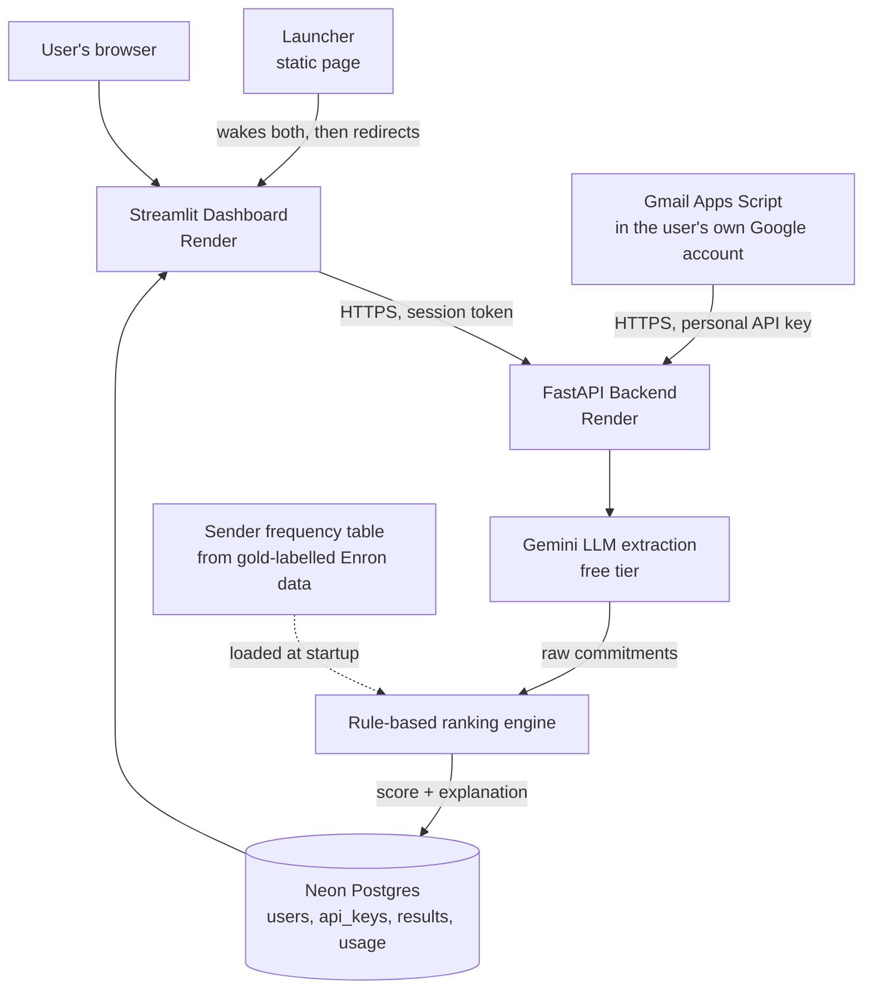

# AI Commitment Intelligence System

Extracts commitments (who promised what, to whom, by when) from email text,
ranks them by urgency, and explains each ranking in plain language, so a
professional never loses track of what they owe or are owed.

**🔗 Open the app:** https://ai-commitment-launcher.onrender.com/
*The launcher wakes the API and the dashboard together, then sends you to the
dashboard. Free-tier hosting sleeps after about 15 minutes of inactivity, so the
first visit can take a minute or two. This is expected, not a bug.*

| Part | URL |
|---|---|
| Launcher (share this one) | https://ai-commitment-launcher.onrender.com/ |
| Dashboard | https://ai-commitment-intelligence.onrender.com/ |
| API | https://ai-commitment-api.onrender.com |

> **Privacy first:** email text is sent to Google's *free* Gemini tier, where
> Google may use it to improve its products. Use sample or non-confidential
> emails, and don't use this demo from the EEA, Switzerland or the UK.
> See [Privacy & data handling](#privacy--data-handling).

---

## What it does

1. **Sign up** with a userid and password (no email, so no password reset).
2. **Paste or upload** an email or thread, **or connect Gmail** (optional, see below).
3. The system **extracts** every commitment (made or requested) with sender,
   recipient, deadline and confidence.
4. It **scores** each one from 0 to 100 and shows a plain-language
   **explanation** of why it was ranked where it was.
5. Results are shown **per user**, kept for 7 days, and can be deleted at any time.

**Gmail connection (optional).** The dashboard generates a personal key and a
ready-to-paste Google Apps Script. The script runs inside the user's own Google
account, looks only at conversations labelled `CommitmentAI-Send`, and sends the
body text of the newest message to the API every 5 minutes. Processed threads
get `CommitmentAI-Done` (or `CommitmentAI-Failed`). No Google password or OAuth
token is ever sent to this app.

## Architecture



- The dashboard calls the API from the Streamlit server. It waits for the API to
  answer `/health` before showing the login form.
- Only the extracted fields are stored. The full email text is not saved.
- Login uses a signed session token (12 hours). The Gmail script uses a separate
  personal API key, stored only as a SHA-256 hash.

## Results

### Extraction (test set, held out, touched once)

| Metric | Score |
|---|---|
| Precision | 0.957 |
| Recall | 0.843 |
| F1 | 0.897 |
| Direction accuracy | 100% |

1,190 gold-labelled commitments from a 750-thread Enron Email Corpus subset
plus 10 synthetic edge-case threads, 70/15/15 split. Error analysis: 36
mismatches across 6 categories (see [`docs/phase6_evaluation.md`](docs/phase6_evaluation.md)).

### Ranking (validation sample, 60 commitments, one human rater)

| Metric | Scorer | 95% bootstrap CI | Random (expected) |
|---|---|---|---|
| Spearman rho | 0.426 | [0.182, 0.635] | -0.005 |
| Pairwise accuracy | 0.705 | [0.592, 0.810] | 0.497 |
| NDCG@10 | 0.635 | [0.491, 0.845] | 0.429 |

The scorer agrees with a human urgency judgement better than chance (moderate
agreement). On this sample it was **not** better than ordering by deadline
alone; that comparison was exploratory and is inconclusive. The labels measure
urgency only, not importance. Full method, limits and error analysis:
[`docs/RANKING_EVALUATION.md`](docs/RANKING_EVALUATION.md) and
[`docs/RANKING_EVALUATION_RESULTS.md`](docs/RANKING_EVALUATION_RESULTS.md).

### Multi-user system

Ten end-to-end checks on the live deployment (signup and consent, generic login
errors, data isolation between accounts, Gmail connection with a second Google
account, key isolation, invalid key returns 401, login throttling, data surviving
an API restart, delete my data, delete my account) were reported as passing by
the project owner. Details and what was not covered:
[`docs/MULTI_USER_TEST_REPORT.md`](docs/MULTI_USER_TEST_REPORT.md).

## Tech stack

| Layer | Tool |
|---|---|
| Extraction | Gemini free-tier API (`google-genai` SDK), few-shot prompting |
| Ranking | Rule-based scorer: 50% deadline urgency, 25% confidence, 15% sender frequency, 10% explicitness (`src/rank_score.py`) |
| Backend | FastAPI (`app/main.py`) |
| Frontend | Streamlit (`app/frontend.py`) |
| Accounts | bcrypt password hashes, signed session tokens (PyJWT), per-user API keys (`src/auth.py`) |
| Database | Postgres via `psycopg2` (Neon on the live system) (`src/db.py`) |
| Gmail ingestion | Google Apps Script generated per user |
| Deployment | Docker on Render (API and dashboard as separate web services), launcher as a Render static site |

## Deployment

Three Render services, plus the database:

| Service | Type | Notes |
|---|---|---|
| API | Web service, Docker | Needs the variables in the first table below |
| Dashboard | Web service, Docker | Needs `API_URL` |
| Launcher | Static site | Publish directory `launcher` |
| Database | Neon Postgres (free tier) | Connection string goes in `DATABASE_URL` on the API |

**API service environment variables**

| Variable | Required | Meaning |
|---|---|---|
| `GOOGLE_API_KEY` | yes | Gemini API key |
| `DATABASE_URL` | yes | Postgres connection string. Without it `/signup` and `/login` return 503 |
| `SESSION_SECRET` | yes | At least 32 characters. Without it `/signup` and `/login` return 503 |
| `MAX_TEXT_CHARS` | no | Default 8000 |
| `DAILY_LIMIT_PER_USER` | no | Default 30 emails per user per day |
| `RESULT_RETENTION_DAYS` | no | Default 7 |
| `MAX_RESULTS_PER_USER` | no | Default 200 |
| `KILL_SWITCH` | no | `on` pauses signup and processing (login, viewing and deleting still work) |
| `INGESTION_SECRET` | no | Legacy single-user path, kept only for backward compatibility |

**Dashboard service environment variables**

| Variable | Required | Meaning |
|---|---|---|
| `API_URL` | yes | Public URL of the API service (default `http://localhost:8000` for local use) |
| `WAKE_MAX_SECONDS`, `WAKE_POLL_SECONDS` | no | Cold-start wait and poll interval (defaults 75 and 3) |

Never commit secrets; set them in the Render dashboard.
The numbers shown in the in-app privacy notice are the defaults above, so if you
override a limit, update the notice too (a test compares them).

**Rollback:** `git revert <commit>` then `git push` (Render redeploys), or
redeploy a previous deploy from the Render dashboard.

**Free-tier behaviour:** services sleep after about 15 minutes without traffic,
and free web services share a monthly instance-hour allowance, so keeping both
awake around the clock is not possible on the free plan. The launcher and the
dashboard's wake-up screen reduce the wait; they do not remove it.

## Running it locally

```bash
pip install -r requirements.txt

# Terminal 1 - API
export GOOGLE_API_KEY="your-key"           # PowerShell: $env:GOOGLE_API_KEY="..."
export DATABASE_URL="postgresql://..."     # needed for accounts
export SESSION_SECRET="at-least-32-random-characters"
uvicorn app.main:app --reload --port 8000

# Terminal 2 - Dashboard
streamlit run app/frontend.py              # API_URL defaults to http://localhost:8000
```

The multi-user features need a Postgres database with the four tables
(`users`, `api_keys`, `results`, `usage`). The table definitions are not
included in this repository yet; without `DATABASE_URL` the API still starts but
signup and login return 503.

Docker (runs both processes in one container, which is convenient for local use;
on Render they are separate services):

```bash
docker build -t commitment-intelligence .
docker run -p 7860:7860 -e GOOGLE_API_KEY="your-key" -e DATABASE_URL="..." \
           -e SESSION_SECRET="..." commitment-intelligence
```

## Tests

```bash
python -m pytest -q
```

| Area | File |
|---|---|
| Privacy page, and checks that the notice matches the code | `tests/test_privacy_page.py` |
| API wake-up gating and Retry | `tests/test_wake_up.py` |
| Ranking evaluation maths and safeguards | `tests/test_ranking_eval.py` |

Some tests need `data/gold_set/v1/` to be present and skip themselves otherwise.

## Project structure

```
app/
  main.py                # FastAPI: auth, /health, /process, /results, /apikey, /usage ...
  frontend.py            # Streamlit dashboard (login, results, Connect Gmail, Privacy)
src/
  gemini_extractor.py    # LLM-based commitment extraction
  rank_features.py       # Feature engineering for ranking
  rank_score.py          # Urgency scoring + explanation generation
  auth.py                # Password hashing, session tokens, API-key hashing
  db.py                  # Postgres connection helper
  ranking_eval.py        # Ranking evaluation against human urgency labels
data/
  gold_set/v1/           # 1,190 gold-labelled commitments, train/val/test split
  ranking_eval/          # Blind labelling sheet, manifest and results for the ranking evaluation
launcher/index.html      # Static page that wakes the API and dashboard
tests/                   # Automated tests
docs/                    # Evaluation write-ups, privacy and security, test reports
Dockerfile, start.sh, requirements.txt
```

## Documentation

| Document | What it covers |
|---|---|
| [`docs/PRIVACY_AND_SECURITY.md`](docs/PRIVACY_AND_SECURITY.md) | What is stored, third parties, controls, known risks, how to verify |
| [`docs/MULTI_USER_TEST_REPORT.md`](docs/MULTI_USER_TEST_REPORT.md) | The ten live multi-user checks and what they did not cover |
| [`docs/RANKING_EVALUATION.md`](docs/RANKING_EVALUATION.md) | Ranking evaluation method, labelling guide, limitations |
| [`docs/RANKING_EVALUATION_RESULTS.md`](docs/RANKING_EVALUATION_RESULTS.md) | Ranking results and error analysis |
| [`docs/phase6_evaluation.md`](docs/phase6_evaluation.md) | Extraction evaluation and error analysis |

## Privacy & data handling

Users sign up with a userid and password only (no email, so **no password
reset**). Only the *extracted* commitments are stored, per user, for 7 days; the
full email text is not saved. Email text is sent to Google's Gemini API on the
free tier, where Google may use content to improve its products, so the demo
should only be used with sample or non-confidential emails. Google's terms for
that tier do not allow it to be offered to users in the EEA, Switzerland or the
UK, so the demo is not intended for those regions (this is a disclosure, not a
technical block).

- In the app: sidebar → **Privacy & consent** (also readable before sign-up).
- Technical details, evidence labels and known limitations:
  [`docs/PRIVACY_AND_SECURITY.md`](docs/PRIVACY_AND_SECURITY.md).

This is a student demo: no professional security audit or legal review.

## Known limitations (disclosed, not hidden)

- **Sender identification** can resolve to a pronoun (e.g. "I") on first-person
  text with no named signoff.
- **Conditional deadlines** ("if the client signs off today, we need X by
  Friday") extract the deadline but do not preserve the condition.
- **Deadlines are not resolved against the email date.** A phrase such as "next 4
  weeks" or "January 23" that matches no keyword gets a moderate default, and
  urgency expressed without a deadline phrase is scored low. The ranking
  evaluation measured the effect of this.
- **Ranking agreement is moderate** and was measured on 60 items with one rater.
- **Gmail polling** runs every 5 minutes (not instant), and a network timeout can
  rarely cause a duplicate result.
- **Free-tier hosting:** cold starts after inactivity; no availability guarantee.
- **The project owner can technically read stored results** (administrative
  access to the hosting and database).
- **Login throttling is kept in memory** and resets when the API restarts;
  session tokens cannot be revoked before they expire.

## Scope note

This is a deliberately narrowed slice of a larger "AI professional memory"
concept. Full relationship graphs, opportunity recovery and cross-platform
memory are explicitly out of scope and documented as future work, not silently
dropped. Full OAuth-based inbox integration is also out of scope; the Gmail
connection uses a self-authored script in the user's own account instead.
