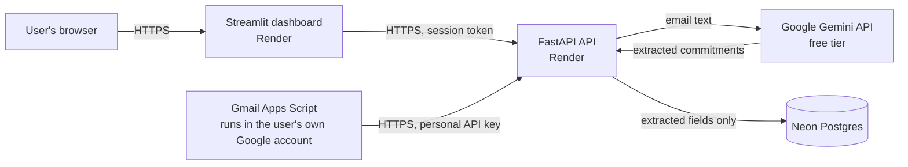

# Privacy & Security: how the system handles data

*Last updated: October 2026 · Covers the deployed multi-user version (Neon Postgres, login + personal API keys, Gmail Apps Script ingestion).*

This document describes what the code **actually does**. It is written for the project report and defense, and it is the technical companion to the user-facing **Privacy & consent** page in the dashboard (sidebar → *Privacy & consent*, or the expander on the login screen).

**Scope and honesty.** This is a student demo project. It has had no professional security audit and no legal review. Nothing below is a compliance claim (GDPR, SOC 2, etc.). Each statement carries an evidence label:

| Label | Meaning |
|---|---|
| **Code** | Verified by reading the source in this repository. |
| **Test** | Covered by an automated test in `tests/` (see "How to verify"). |
| **Owner-tested** | Reported as manually tested on the live deployment by the project owner. Not independently re-run for this document. |
| **Unverified** | Believed true or intended, but not yet confirmed. Listed so it can be checked, not assumed. |

---

## 1. Data flow



- The dashboard calls the API from the Streamlit server, not directly from the browser.
- The Gmail script sends only the **plain-text body of the newest message** in each conversation the user labelled `CommitmentAI-Send`, cut to the first 8,000 characters, plus the user's personal key. It does not send the subject or sender header. (**Code**, **Test**)
- The API sends the email text to Gemini, ranks the returned commitments with the rule-based scorer, and stores only the extracted fields.

## 2. What is stored

| Data | Table / place | Form | Evidence |
|---|---|---|---|
| Userid | `users` | Plain text | Code |
| Password | `users.password_hash` | bcrypt hash with per-password salt; plaintext never stored | Code, Test |
| Personal Gmail key | `api_keys.key_hash` | SHA-256 hash only. The key is 256 bits of randomness, shown once at creation | Code, Test |
| Extracted commitments | `results` | `commitment_text`, `direction`, `deadline_type`, `deadline_text`, `confidence`, `sender`, `recipient`, `urgency_score`, `explanation`, `source`, `processed_at` | Code, Test |
| Daily usage counter | `usage` | Count of emails processed per user per UTC day; rows older than 30 days are purged | Code |
| Legacy results (transition path, section 8) | API process memory | Not in the database; lost on restart | Code |

**Not stored in the database:** the full email text, subject lines, or sender headers. The `INSERT INTO results` statement has no column for them, and a test fails if one is added. (**Code**, **Test**)

**Important nuance:** `commitment_text`, `sender` and `recipient` are fragments of the user's email stored exactly as extracted. They are **not anonymised** and can contain names and other personal details. The "basic anonymization (name/email hashing)" described in the project scope applies to the **public Enron training/evaluation data only**, not to live user data.

## 3. Logging

Application logs (Render's log stream) contain: startup messages, configured limits, extraction/ranking/total processing times, the count of commitments extracted, and warnings such as a failed cleanup. No `print` or logging call interpolates request text, extracted text or credentials. A test scans `app/main.py` for this. (**Code**, **Test**)

Limits of this claim: Render and Neon keep their own platform logs and backups (request metadata, database history) that this project does not control. (**Unverified**: exact retention of those provider-side records.)

## 4. Third parties

| Party | Receives | Notes |
|---|---|---|
| Google, Gemini API (free tier) | The text of every email processed | On the free tier Google's terms allow use of submitted content to improve its products, and human review. See section 6 for the regional restriction. |
| Google, Gmail / Apps Script | Nothing from this app. The script runs inside the user's own Google account | The app never receives a Google password or OAuth token. (**Code**) |
| Render | Hosts dashboard and API; sees traffic as a hosting provider | The live URLs are `https://…onrender.com`. |
| Neon | Hosts the Postgres database | Contents as in section 2. |
| Project owner | Administrative access to Render and Neon, so can technically read stored results and the API's environment | Disclosed on the Privacy & consent page. |

## 5. Security controls

| Control | How it works | Evidence |
|---|---|---|
| Password storage | bcrypt, min 8 chars, max 72 bytes (rejected rather than silently truncated) | Code, Test |
| Sessions | Signed JWT (HS256), expires after 12 hours, held only in the browser tab's session state | Code, Test |
| Session revocation | **Not possible.** Tokens are stateless; a copied token stays valid until it expires | Code (documented trade-off in `src/auth.py`) |
| Login errors | Same generic message for unknown userid and wrong password; a dummy bcrypt check equalises timing | Code, Test |
| Brute-force throttle | 5 failures per userid per 10 minutes, then blocked. **In-memory:** resets on API restart and is per-process | Code; Test checks the numbers only, not the blocking behaviour |
| API-key auth | `X-API-Key` header, key hashed and looked up; a bad key is rejected, not retried on another path | Code |
| Data isolation | Every results/usage query is scoped by the authenticated user's id | Code; **Owner-tested** manually on the live site |
| Limits | 30 emails/user/day, 8,000 chars/email, 200 results/user, 15 accounts total, hourly cleanup of results older than 7 days | Code, Test (numbers match the notice) |
| Kill-switch | `KILL_SWITCH=on` pauses signup and processing; login, view and delete still work | Code |
| Secrets | `DATABASE_URL`, `SESSION_SECRET`, `GOOGLE_API_KEY` are read from environment variables, not hard-coded. (Whether any secret was ever committed to Git history has not been audited.) | Code |

## 6. Consent and the regional restriction

**Consent mechanics.** Creating an account requires ticking *"I have read and understand the above"* next to the sign-up notice, and the full notice is readable before signing up. The tick is a gate in the dashboard only: **the app does not store a record of who ticked or when.** Consent is withdrawn by deleting the account. (**Code**, **Test**)

**Regional restriction.** Google's Gemini API Additional Terms state that apps offered to users in the European Economic Area, Switzerland or the United Kingdom may use only Paid Services. This project uses the free tier, so it is **not intended for users in those regions**. The restriction is disclosed on the sign-up screen and the Privacy & consent page. **It is not technically enforced**: there is no location check, so it relies on the user. Terms can change, so re-read them at <https://ai.google.dev/gemini-api/terms> before relying on this text. (Terms read: October 2026.)

## 7. User controls

| Action | Where | Effect | Evidence |
|---|---|---|---|
| Delete my data | Dashboard | Deletes all of the user's `results` rows immediately | Code |
| Delete my account | Account (password required) | Deletes the `users` row. Related `api_keys`, `results` and `usage` rows should be removed by foreign-key cascade | Code for the delete; **Unverified** for the cascade, see section 10 |
| Replace the Gmail key | Connect Gmail | New key generated; the stored hash is overwritten, so the old key stops working immediately | Code |
| Stop Gmail processing | Apps Script → Triggers (delete trigger) | No further polling | Documented on the Connect Gmail page; not separately tested here |
| Password recovery | none | By design (no email collected). A forgotten password means a new account | Code, Test |

## 8. Legacy ingestion path (transition mode)

While `INGESTION_SECRET` is set on the API service, a header `X-Ingestion-Key` is accepted as a "legacy" caller. It uses a **separate in-memory store** and cannot read or write any user's database rows (**Code**). It exists so older single-user scripts keep working. It should be retired by removing the environment variable, **only after confirming no old script or trigger still depends on it**. That step has not been done and needs the owner's explicit approval. Until then, a leaked legacy secret would let its holder submit emails for processing (not read user data).

## 9. Known limitations and risks

1. **Project owner can read stored results.** Not end-to-end encrypted.
2. **No session revocation** before the 12-hour expiry.
3. **Login throttle is in-memory** and resets on restart; it would not coordinate across multiple API instances.
4. **Stored fragments are not anonymised.**
5. **Free-tier Gemini terms:** content may be used by Google; regional restriction not enforced.
6. **No consent record** is stored.
7. **Cleanup depends on traffic:** results older than 7 days are hidden immediately but physically deleted by a purge that runs at most hourly, triggered by authenticated requests. If nobody uses the service, deletion waits for the next request.
8. **Provider-side backups/logs** (Render, Neon) are outside this project's control.
9. **Duplicate processing** can rarely occur after a network timeout in the Gmail script.
10. **Free-tier hosting** sleeps and cold-starts; no availability guarantee.
11. **Not audited:** no penetration test, dependency audit, or legal review.

## 10. How to verify

**Automated (no network, no secrets):**

```powershell
python -m pytest -q tests/test_privacy_page.py tests/test_wake_up.py tests/test_connect_gmail_ux.py
```

**Confirm foreign-key cascade (read-only SQL, run in the Neon SQL editor).** `confdeltype = 'c'` means `ON DELETE CASCADE`:

```sql
SELECT conrelid::regclass AS child_table, confdeltype
FROM pg_constraint
WHERE contype = 'f' AND confrelid = 'users'::regclass;
```

Expected: `api_keys`, `results` and `usage` each listed with `c`. If any shows `a` (no action), deleting an account would fail or leave rows behind, and the Privacy & consent page's account-deletion sentence must be corrected before release.

**Manual live checklist:**

1. Sign up as a new user: the notice shows the EEA/Switzerland/UK line and the *Read the full Privacy & consent notice* expander opens.
2. Sidebar → *Privacy & consent* renders when logged in.
3. Process a test email, then **Delete my data**: Dashboard is empty.
4. Create a second account, process an email, **Delete my account**, then confirm in Neon that no `results`, `api_keys` or `usage` rows remain for that user id.
5. With two accounts, confirm account A never sees B's results (already owner-tested; repeat after each release).

## 11. Mapping to the Multi-User Extension acceptance checks (roadmap v2)

| Acceptance check | Status in this document |
|---|---|
| User A never sees User B's data | Code scopes by user id; **owner-tested** live |
| Generic auth failure, no userid disclosure | Code, Test |
| Lost password has no recovery, disclosed at signup | Code, Test |
| Invalid/regenerated API key returns 401 | Code; live result not recorded here |
| Rate limit returns 429 | Code; live result not recorded here |
| Data survives a Render restart (Neon, not memory) | Code (results are in Neon); live restart test not recorded here |
| "Delete my data" leaves no residue | Results rows deleted (Code); usage counters are not results and expire after 30 days; account-delete cascade **Unverified** (section 10) |
| Independent test with a second, separate account and Google account | Not evidenced here. This is Task 9 |

## 12. Change log

| Date | Change |
|---|---|
| October 2026 | Added the Privacy & consent page (sidebar and login screen), the regional-restriction disclosure, the claim-vs-code tests, and this document. No change to authentication, storage, limits or the extraction/ranking pipeline. |
